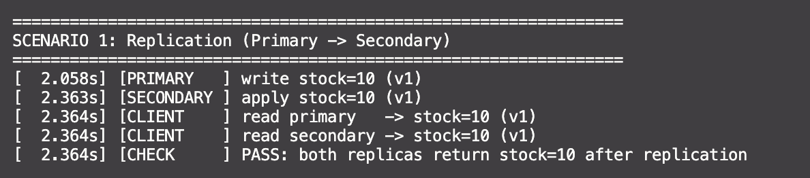
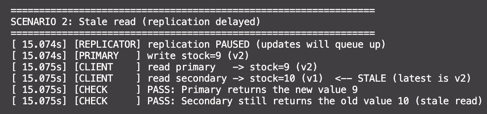
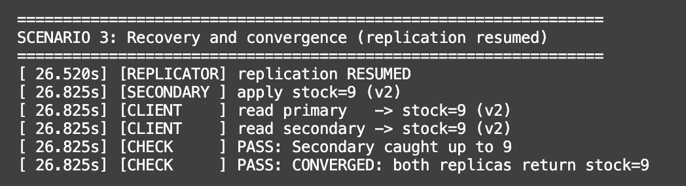

# Module 8: Stale Reads and Replica Recovery

A small simulation of a replicated inventory system with **1 Primary** and
**1 Secondary** replica. Writes go to the Primary and are replicated
asynchronously to the Secondary. Pausing replication shows a **stale read**
on the Secondary, and resuming it shows the replicas **converging** again.

Written in Python 3 using only the standard library (no dependencies).

## How to Run

Requires Python 3.8+ (developed on 3.10).

```bash
# Run all three scenarios (replication, stale read, recovery)
python3 main.py

# Same, but pause for Enter between scenarios (handy for screenshots)
python3 main.py --step

# Run the automated tests
python3 -m unittest -v
```

`main.py` exits with code 0 if every check passes.

## Files

| File | Purpose |
|---|---|
| `replication.py` | `Replica`, `Primary`, `Replicator` (pausable), and `Client` classes |
| `main.py` | Runs the three scenarios and prints timestamped logs with PASS/FAIL checks |
| `test_replication.py` | `unittest` tests for the three requirements plus edge cases |
| `output.txt` | Captured output of `python3 main.py` |
| `test_output.txt` | Captured output of `python3 -m unittest -v` |
| `docs/screenshots/` | Terminal screenshots used below |

## Architecture

```
                 write                      queue
   +--------+ ----------> +-----------+ ------------> +------------+
   | Client |             |  PRIMARY  |   Replicator  | SECONDARY  |
   |        | <---------- |  stock, v |  (pausable,   |  stock, v  |
   +--------+    read     +-----------+  has delay)   +------------+
        |                                                    ^
        +----------------------- read -----------------------+
```

- The **Client** writes only to the Primary, but can read from either replica.
- Each write bumps a **version number** on the Primary and is placed on a
  replication queue.
- The **Replicator** thread applies queued updates to the Secondary after a
  simulated network delay (0.3s). It can be **paused**: updates stay queued
  (nothing is lost) and are applied in order once it is **resumed**.
- A read is flagged **STALE** when the replica's version is behind the
  Primary's version.

## Evidence

Full output is in [`output.txt`](output.txt).

### 1. Successful replication

The Primary receives `stock=10`, the Secondary applies it about 0.3s later,
and both replicas return the same value.



```
[  0.000s] [PRIMARY   ] write stock=10 (v1)
[  0.305s] [SECONDARY ] apply stock=10 (v1)
[  0.306s] [CLIENT    ] read primary   -> stock=10 (v1)
[  0.306s] [CLIENT    ] read secondary -> stock=10 (v1)
[  0.306s] [CHECK     ] PASS: both replicas return stock=10 after replication
```

### 2. Stale-read test

Replication is paused, then the Primary is updated from `stock = 10` to
`stock = 9`. The Primary returns `9`, but the Secondary still returns the old
value `10`, which is a stale read.



```
[  0.306s] [REPLICATOR] replication PAUSED (updates will queue up)
[  0.306s] [PRIMARY   ] write stock=9 (v2)
[  0.306s] [CLIENT    ] read primary   -> stock=9 (v2)
[  0.306s] [CLIENT    ] read secondary -> stock=10 (v1)  <-- STALE (latest is v2)
[  0.306s] [CHECK     ] PASS: Primary returns the new value 9
[  0.306s] [CHECK     ] PASS: Secondary still returns the old value 10 (stale read)
```

### 3. Recovery and convergence

Replication is resumed. The Secondary applies the queued update and both
replicas return `9` again.



```
[  0.306s] [REPLICATOR] replication RESUMED
[  0.611s] [SECONDARY ] apply stock=9 (v2)
[  0.611s] [CLIENT    ] read primary   -> stock=9 (v2)
[  0.611s] [CLIENT    ] read secondary -> stock=9 (v2)
[  0.611s] [CHECK     ] PASS: Secondary caught up to 9
[  0.611s] [CHECK     ] PASS: CONVERGED: both replicas return stock=9
```

### Automated tests

`python3 -m unittest -v` runs 5 tests (replication, stale read, convergence,
in-order replay of multiple queued writes, and ignoring out-of-date
versions). All pass; see [`test_output.txt`](test_output.txt).

## Reflection

**What tradeoff exists between reading quickly from a replica and
guaranteeing that the reader sees the latest value?**

TODO: write your 3-5 sentence reflection here.
